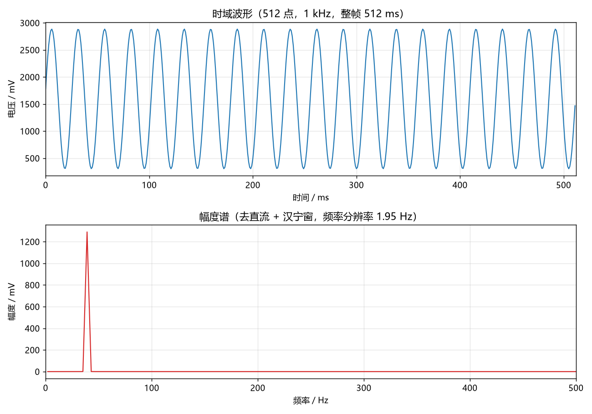

# STM32F103 信号采集与频谱分析装置

采集 512 点波形 → 串口自定义帧传输 → PC 端时域波形 + FFT 幅度谱 + THD。

指标对齐 2021 年全国大学生电子设计竞赛 A 题（信号采集与频谱分析）。

## 实测结果

| 指标 | 要求 | 实测 | 余量 |
|---|---|---|---|
| 频率误差 | < 2% | **0.10%** | 20× |
| 幅度误差 | < 5% | **0.02%** | 250× |
| THD | 与真值偏差 < 5% | **0.027%** | 12 位量化理论极限约 0.02% |

```
直流电平 1595.5 mV，峰峰值 2580.4 mV（范围 305.4—2885.8）
峰值频率 39.1 Hz（分辨率 1.95 Hz），幅度 1290.2 mV
基波 39.06 Hz，幅度 1290.2 mV
THD = 0.027 %（2—10 次谐波）
谐波幅度：0.08 0.28 0.10 0.05 0.07 0.09 0.04 0.05 0.09 mV
```



## 系统结构

```
正弦表(128点) --DMA2_CH3--> DAC_CH1(PA4) --跳线回环--> ADC_CH1(PC4) --> adc_buf[512]
                                   TIM6 5kHz                        TIM3 1kHz (TRGO 硬件触发)
                                                                         |
                            PC: 时域 / FFT / THD  <--USART1 115200-- 帧组装(CRC16)
```

| 项目 | 参数 |
|---|---|
| 采样率 | 1 kHz（TIM3：PSC=71, ARR=999） |
| 每帧点数 | 512（512 ms，频率分辨率 1.953 Hz） |
| DAC 更新率 | 5 kHz（TIM6：PSC=71, ARR=199） |
| 输出正弦 | 39.0625 Hz（5 kHz / 128 点，正好落在 FFT 第 20 格） |
| 帧长 | 1030 字节 |

### 帧格式

| 偏移 | 长度 | 内容 |
|---|---|---|
| 0—1 | 2 | 帧头 `AA 55` |
| 2—3 | 2 | 帧序号（小端） |
| 4—1027 | 1024 | 512 × uint16（小端，0—4095） |
| 1028—1029 | 2 | CRC-16/CCITT-FALSE，覆盖前 1028 字节 |

串口是字节流没有帧边界，所以定帧头对齐、定序号查丢帧、加 CRC 查误码。

## 三个关键点

**1. 为什么必须用 DMA 而不是中断**

第一版用"定时器触发 + ADC 转换完成中断"，实测中断频率 75930 次/秒，数据完全无效。
算账：ADC 转换 7 μs + 进出中断 6 μs ≈ 13 μs → 理论上限 7.7 万次/秒，与实测吻合。
结论：**中断开销和采样间隔同量级时，架构从根上不可行，优化代码救不回来**。改 DMA 后 CPU 每 512 ms 才被唤醒一次。

**2. 配置正确 ≠ 外设在工作中**

最难的一次：`ADC1->DR` 有正常数据、`CR2=0x00180101` 全部正确，但 `CNDTR=0`、`DMA1->ISR=0`、缓冲区全 0。
根因：CubeMX 把 DMA 生成为独立外设（`dma.c`），但 `main()` 没调用 `MX_DMA_Init()`，**DMA1 时钟没开**。
检查顺序：**先时钟、再中断、最后参数**。

**3. 上位机的三个坑**

- pyserial 打开端口默认拉高 DTR/RTS，把板载 CH340 的自动下载电路触发 → MCU 一直在复位 → 收到 0 字节。解法 `dsrdtr=False` + `setDTR(False)`。
- 512 点截断导致首尾不连续 → 频谱泄漏，加汉宁窗 + 相干增益补偿 `2|X|/(N·mean(w))`。
- 直流信号也会出现"峰值"，那是单帧噪声尖峰，多帧平均可降 √N。

## 复现

1. 开发板 `AD/DA` 排针**横插上排**（DAC—ADC 短接，PA4→PC4 回环）
2. CubeIDE 打开 `firmware/1_03_dma.ioc` 生成工程（Toolchain 选 STM32CubeIDE，SYS/Debug 选 Serial Wire），编译烧录
3. 上位机

```bash
pip install pyserial numpy matplotlib
python host/check_frame.py     # 验证帧完整性与 CRC
python host/plot_wave.py       # 收一帧，画时域与频谱，输出 wave.png
```

4. 常见故障：串口被其他软件占用（Access denied）／跳线插成竖排（在测电位器，得到直流）／`MX_DMA_Init()` 缺失（CNDTR 恒 0）

## 关于开发方式

代码由 AI 编程助手生成初稿，本人负责：CubeMX 外设配置、编译烧录、逐轮实机调试、问题定位与结论验证（如中断风暴的频率测算、DMA 时钟缺失的根因确认、DAC 输出 56 mV 固定偏置的推导）。文中每个故障现象都在本人设备上复现过。

## 串口命令（运行时配置）

USART1 接收中断每收一个字节进环形缓冲区，主循环按 `\n` 切行解析。支持两条命令：

| 命令 | 作用 | 应答 |
|---|---|---|
| `SET <毫秒>` | 设灯亮时长（灭 = 亮 × 2），范围 50—20000 | `OK on=500 off=1000` |
| `GET` | 查询当前配置 | `on=500 off=1000` |
| 其他 | — | `ERR unknown` |

```
SET 500
OK on=500 off=1000
```

设计要点：

- **中断只搬字节，解析在主循环**——环形缓冲区吸收两者的速度差。这是 `ringbuf` 在项目里的实际用途。
- **收不定长必须 `Size=1`**：`HAL_UART_Receive_IT` 是"收满固定长度才回调"，而对方发多少字节事先不知道，只能逐字节收进缓冲区。
- **溢出整行作废**：缓冲区满时置 `line_overflow`，到行尾丢弃整行并回错误。只清计数会导致后半截重新写入，解析出一个你没发过的命令。
- **参数必须校验范围**：`SET 0` 会让灯每 0 ms 翻转，主循环被 `led_task` 占满，采集帧再也发不出去。

## 已知限制

- **调试显示冲突**：同一条串口上既有二进制采样帧（需 HEX 显示）又有文本命令应答（需 ASCII 显示），串口助手无法同时正确显示。改进方向：上位机按帧头分流——`AA 55` 开头走二进制解析，其余按文本打印。
- **参数未持久化**：`SET` 改的闪灯周期只存在 RAM，复位后回到默认值。改进方向：写入内部 Flash（按页擦除 → 编程 → 开机读回）。
- **DAC 输出有 −56 mV 固定偏置**：峰峰值与理论差 0.06%（增益正确），但中点偏移 55.8 mV。频率与幅度用峰峰值差分测量，该偏置相消；要绝对精度需两点标定。

## 可继续改进

- 多帧平均降噪（√N）
- 平顶窗改善幅度测量
- 帧协议加应答/重传，从单向广播改为可靠传输
- 用输入捕获测外部信号，脱离回环做真实测量
